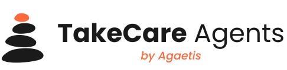
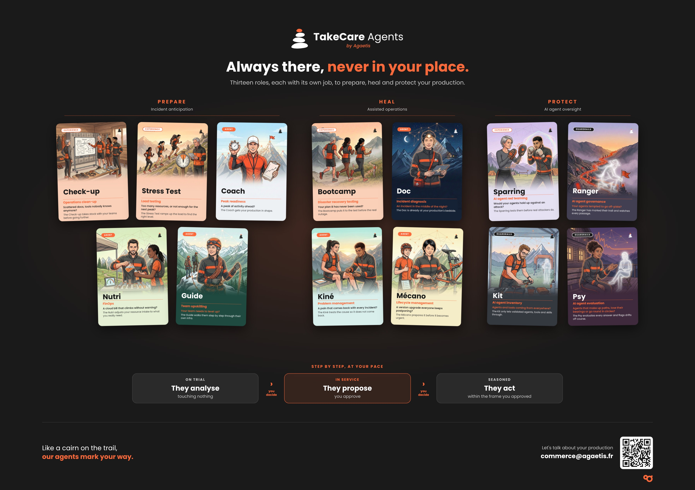

<p align="center">
  <picture>
    <source media="(prefers-color-scheme: dark)" srcset="docs/assets/takecare-logo-white.svg">
    
  </picture>
</p>

<p align="center"><b>The AI that helps you take care of your production.</b><br>
<i>Always there, never in your place.</i></p>

---

TakeCare Agents is a collection of specialised roles (AI agents and guardrails) that take care of your production alongside your teams: Kubernetes and the managed cloud services around it. They govern every AI agent, prepare for the peaks and heal incidents down to their cause. It installs at the customer's site as a **Kubernetes operator**, on an open source stack (agentgateway, kagent, agentregistry, MCP), with the model of their choice. A built-in **demo mode** runs the same product on a local cluster, with a scenery and replayable incidents.

> **Status.** The **Doc** works end to end: an alert in, a sourced diagnosis published, with its trace and its cost, on the demo or on your cluster. The **Ranger** puts the same rules on every agent at the gateway: a journal, masking, filtering, caps and allowed models. The images and charts of the latest release are on `ghcr.io/agaetis-it` (see the [CHANGELOG](CHANGELOG.md)); `make demo-up` installs them. The other roles are specified, not coded yet.

## The staff

Nine roles, each with its own job, in three pillars of three. Each role has a nickname you remember and a job name that says what it does in operations. A role can run several agents, each with its own scope (one Doc per cloud, for instance). Every agent starts as an apprentice, touching nothing.

<p align="center">
  
</p>

| Pillar | Role | Job name | The question it answers |
|---|---|---|---|
| **Govern**<br><sub>The agentic foundation</sub> | **Intendant** | Infra inventory and mapping | Agents and tools coming from everywhere? |
| | **Ranger** | AI agent governance | Your agents tempted to go off-piste? |
| | **Psy** | AI agent quality control | Agents that make up paths or go round in circles? |
| **Prepare**<br><sub>Incident anticipation</sub> | **Coach** | Peak readiness | A peak of activity ahead? |
| | **Nutri** | FinOps | A cloud bill that climbs without warning? |
| | **Guide** | Team upskilling | Your team needs to level up? |
| **Heal**<br><sub>Assisted operations</sub> | **Doc** | Incident diagnosis | An incident in the middle of the night? |
| | **Kiné** | Problem management | A pain that comes back with every incident? |
| | **Mécano** | Lifecycle management | A version upgrade everyone keeps postponing? |

Agents: Intendant, Coach, Nutri, Guide, Doc, Kiné, Mécano. Guardrails, which are not agents and apply to every agent, vendors' agents included: Ranger and Psy.

Milestone 1 delivers the **Doc** (incident diagnosis): on every alert, it investigates read-only and posts a sourced diagnosis to Slack (the root cause, the ruled-out leads, who should act). You decide on the treatment.

## The principle: the level is declared

Every role is a Kubernetes resource that carries its **intervention level**. The operator derives from it what the role is allowed to do. A role is put into service as a Practitioner once it has proven itself as an Apprentice; it becomes an Expert action by action, only where you decided.

| Level | Value | What the role does |
|---|---|---|
| Apprentice | `Apprentice` | It observes, on your history or dry-run, touching nothing |
| Practitioner | `Practitioner` | It works daily and proposes; you approve and launch |
| Expert | `Expert` | It acts alone, action by action, only where you decided (after milestone 1) |

```yaml
apiVersion: takecare.agaetis.fr/v1alpha1
kind: TakeCareDoc
metadata:
  name: doc
  namespace: takecare-system
spec:
  level: Practitioner         # Apprentice | Practitioner | Expert
  scope:
    namespaces: [demo-apps]
  contentTools: [pods_log]    # tools whose result carries payload the Doc may read (ADR 0014)
  connectors:                 # MCP connectors behind the gateway, by type
    cluster: [kubernetes]
    metrics: [prometheus]
    knowledge: [runbooks, incidents]
    map: [map]                # the Map of the ground (spec 08)
    report: report            # the report connector (here: Slack)
  report:
    apprentice: review        # where diagnoses go at each level
    practitioner: on-call
```

Changing level means changing this resource: a reviewed PR, a traced change. `kubectl get takecare -A` lists the whole staff, with each role's level and state.

## Milestone 1 architecture

```text
Alertmanager ──webhook──▶ takecare-operator ──A2A task──▶ kagent agent "doc"
                                │  ◀────── diagnosis ──────────┘    │
                                │                                   │ only the tools its level allows
                                ▼                                   ▼
                  report connector ──▶ Slack        ┌───────── agentgateway ─────────┐
                                                    │  models · MCP tools · A2A      │
                                                    └────────────────────────────────┘
                                                        │                    │
                                        OpenAI-compatible model     connectors (MCP servers):
                                        (customer's choice)         kubernetes, prometheus,
                                                                    runbooks, post-mortems…

every investigation = one OpenTelemetry trace (GenAI semantic conventions) ──▶ OTLP
```

A2A calls, tool calls and model calls all go through agentgateway.

- **`takecare-operator`** (Go, kubebuilder) translates TakeCare resources into building-block configuration and RBAC, triggers investigations and publishes their results. It installs nothing and does not reason itself.
- **kagent** runs the agents ([ADR 0007](docs/adr/0007-agent-engine-kagent.md), confirmed by [spike 001](docs/spikes/001-kagent-doc-engine.md)). Agents talk to each other over **A2A** ([ADR 0009](docs/adr/0009-agents-talk-over-a2a.md)).
- **Connectors**: everything an agent reads or writes is an MCP server behind the gateway; the level decides which tools are allowed ([ADR 0008](docs/adr/0008-everything-is-an-mcp-connector.md)).
- **The `takecare` chart** installs the operator, its CRDs and the third-party building blocks, with a `prod` or `demo` profile.
- **agentgateway** is the single control point: every model call (provider key never exposed, cost measured), every tool call (authorized tool by tool), every agent-to-agent call.
- **OpenTelemetry** from day one, following the [GenAI semantic conventions](https://github.com/open-telemetry/semantic-conventions-genai): the groundwork for the Psy, which will check the agents' answers.

The choices and their reasons are in the [ADRs](docs/adr/).

## Demo mode

The same product on a local k3d cluster, with the `billing-api` scenery and the `proxy-timeout` incident ([spec 03](docs/specs/03-demo.md)). The demo never changes your kube context: its kubeconfig is `bin/takecare-demo.kubeconfig`.

```bash
export TAKECARE_MODEL_API_KEY=...   # or in a .env file (git-ignored), never written to the repository
make demo-up DEMO_IMAGES=build      # k3d cluster, TakeCare with the demo profile, the scenery and the Doc
make demo-incident                  # triggers the failure and prints the expected alert window (about 2 min 30 later)
make demo-verdict                   # waits for the Doc's diagnosis and prints it with its usage
make demo-screens                   # Prometheus, Alertmanager and Jaeger on localhost; demo-screens-stop
make demo-reset                     # puts the scenery back in shape, ready for another incident
make demo-down                      # deletes the cluster and the demo's working files
```

The demo also runs an Intendant ([spec 10](docs/specs/10-intendant.md)), which surveys the scenery and proposes what the demo's Map lacks. It surveys on each new Map revision and on demand: create a `TakeCareSurvey` naming it (`intendantRef: {kind: TakeCareIntendant, name: intendant}`), then read `kubectl -n takecare-system get takecaresurveys` and the survey's status. The first proposals are in its status, the full set in the ConfigMap that `status.proposalsConfigMap` names. The agent pass (spec 10 §5) is not built yet, so a survey holds the import's proposals only.

`DEMO_IMAGES=build` builds the images from this tree and imports them into the cluster. Without it, `demo-up` pulls the images of the version the charts name, the latest release, from the registry. A second `make demo-up` changes nothing and takes seconds. With `TAKECARE_SLACK_BOT_TOKEN` and `TAKECARE_SLACK_ONCALL_CHANNEL` (and optionally `TAKECARE_SLACK_REVIEW_CHANNEL`), diagnoses are posted to Slack; without them they go to the report server's log, and `make demo-verdict` reads them from the investigation. `make demo-bench N=5` runs the accuracy bench on the ongoing incident (see `test/bench/README.md`).

Prerequisites: Docker with at least 4 GB of memory (the stack uses about 3.7 GiB in an incident, measured on k3d with the Intendant's agent), k3d, kubectl, make; Helm 4 is downloaded by the Makefile.

## Documentation

| Document | Content |
|---|---|
| [`docs/specs/00-vision-milestone-1.md`](docs/specs/00-vision-milestone-1.md) | Vision, principles, scope and exit criteria of milestone 1 |
| [`docs/specs/01-platform.md`](docs/specs/01-platform.md) | `TakeCarePlatform`, the core: models, gateway, observability; production vs demo |
| [`docs/specs/02-doc.md`](docs/specs/02-doc.md) | `TakeCareDoc` and `TakeCareInvestigation`: alert intake, kagent agent, tools by level, publishing, cost, traces |
| [`docs/specs/03-demo.md`](docs/specs/03-demo.md) | Demo mode and `TakeCareDemo`: the `proxy-timeout` scenario, `make demo-*` |
| [`docs/specs/04-quality-ci.md`](docs/specs/04-quality-ci.md) | Layout, tests, accuracy bench, CI, definition of done |
| [`docs/specs/05-connectors.md`](docs/specs/05-connectors.md) | `TakeCareConnector` and add-ons: MCP servers behind the gateway, tool classes |
| [`docs/specs/06-role-model.md`](docs/specs/06-role-model.md) | The role model: agents, guardrails, exercises; triggers, records and `RunStatus`; concept → build mapping |
| [`docs/specs/07-role-sheets.md`](docs/specs/07-role-sheets.md) | One page per role of the concept |
| [`docs/specs/08-map.md`](docs/specs/08-map.md) | The Map: ontology, entries, storage in the customer's Git, the `map` connector |
| [`docs/specs/09-ranger.md`](docs/specs/09-ranger.md) | The Ranger: the same rules for every agent through the gateway (masking, filtering, budgets, allowed models), its Markers by level |
| [`docs/specs/10-intendant.md`](docs/specs/10-intendant.md) | The Intendant: the survey, discovery through the connectors, proposals for the Map and the Base camp's registry |
| [`docs/spikes/001-kagent-doc-engine.md`](docs/spikes/001-kagent-doc-engine.md) | Spike 001: can kagent run the Doc as well as HolmesGPT? |
| [`docs/specs/90-agent-output-localization.md`](docs/specs/90-agent-output-localization.md) | Localized agent output (deferred) |
| [`docs/adr/`](docs/adr/) | Architecture decisions |
| [`docs/release.md`](docs/release.md) | Releasing: the tag, what the release workflow publishes, the checks after, fixing forward |
| [`docs/licensing.md`](docs/licensing.md) | License rules: SPDX headers, provenance of copied code, allowed dependency licenses |
| [`AGENTS.md`](AGENTS.md) | How to work on this repository: ground rules, conventions, known pitfalls |

## Development

```bash
make help        # every target
make generate    # deepcopy, CRDs, RBAC manifests
make chart-sync  # copy the CRDs and the pinned versions into the charts
make lint        # golangci-lint, shellcheck, markdownlint, SPDX headers
make chart-docs  # regenerate the charts' README value tables (helm-docs)
make chart-lint  # chart drift checks (CRDs, pins, READMEs) + helm lint, both charts, both profiles
make chart-template  # render both profiles, validate with kubeconform
make test        # unit + golden + envtest + chart tests
make licenses    # dependency license check, regenerates NOTICE
make gitleaks    # secret scan
make docker-buildx   # operator image, amd64 + arm64
```

Prerequisites: Go (version in `go.mod`), Docker, make. Every pinned version lives in [`hack/versions.env`](hack/versions.env); the linters run from pinned images, the Go tools, Helm 4 and kubeconform are installed into `./bin` (Helm runs with its own repository config there, never yours).

The charts live in [`charts/`](charts/), each with its own README to read before installing: [`takecare-crds`](charts/takecare-crds/README.md) (the CRDs, to install and upgrade first, never uninstalled while TakeCare runs) and [`takecare`](charts/takecare/README.md) (the operator and its building blocks: prerequisites, security requirements, values); a cluster that an administration cluster supervises installs [`takecare-cluster`](charts/takecare-cluster/README.md) instead (the read-only `kubernetes` MCP server behind its mTLS front, ADR 0016). `values-prod.yaml` is the template a customer fills, every value to set marked `# REQUIRED`; `values-demo.yaml` is complete.

## How we work

Specs and decisions are written and reviewed before the code. Every spec leads to a PR, reviewed before merging. A decision that changes gives a new ADR, never a rewrite of the old one. Everything in this repository is written in English; only the role names keep their French flavour.

## Contributing

Contributions are welcome. [`CONTRIBUTING.md`](CONTRIBUTING.md) explains the development environment, the conventions, the DCO sign-off and how a pull request is reviewed; [`AGENTS.md`](AGENTS.md) is the rulebook. Issues labelled [`good first issue`](https://github.com/Agaetis-IT/takecare-agents/labels/good%20first%20issue) are a good place to start. Report a vulnerability privately, as [`SECURITY.md`](SECURITY.md) explains. Everyone taking part follows the [code of conduct](CODE_OF_CONDUCT.md).

## License

Apache License 2.0, copyright Agaetis: see [`LICENSE`](LICENSE).
Third-party notices are in [`NOTICE`](NOTICE); the rules that keep the provenance clean (SPDX headers, copied code, no strong copyleft) are in [`docs/licensing.md`](docs/licensing.md).

---

<p align="center"><i>Like a cairn on the trail, our agents mark your way.</i><br>
TakeCare Agents by <a href="https://www.agaetis.fr">Agaetis</a></p>
